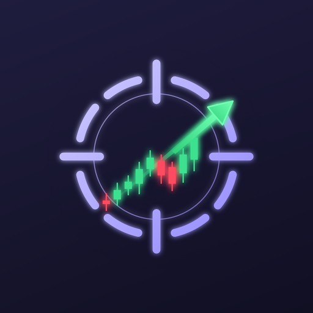
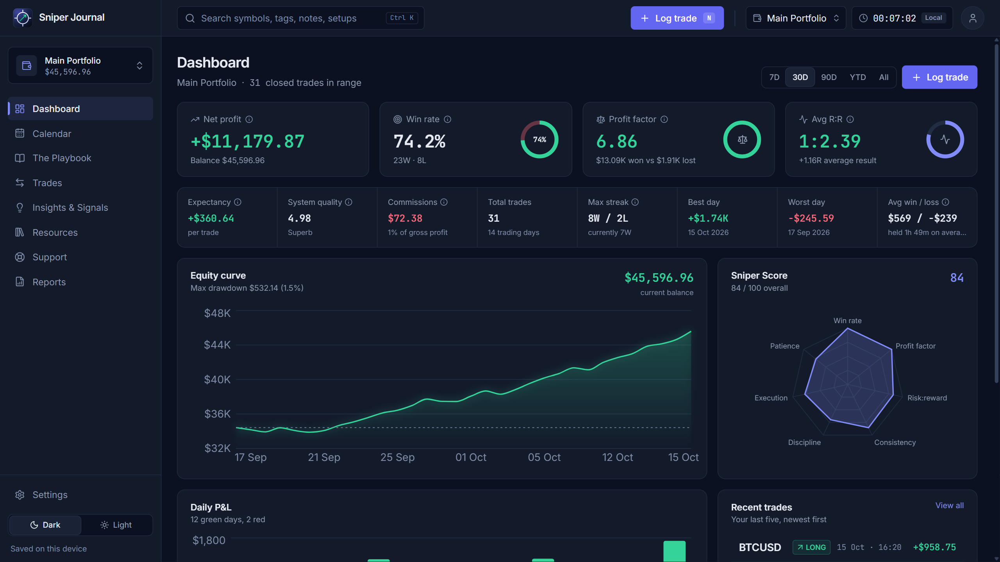
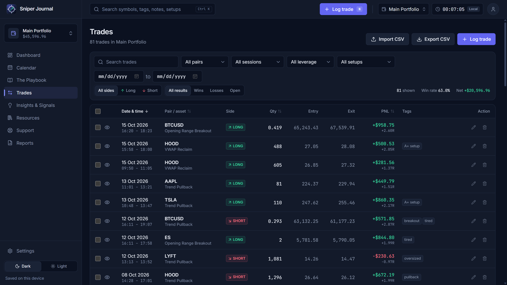
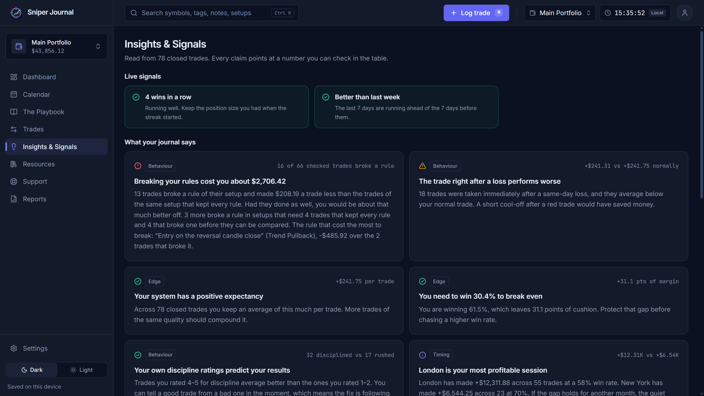
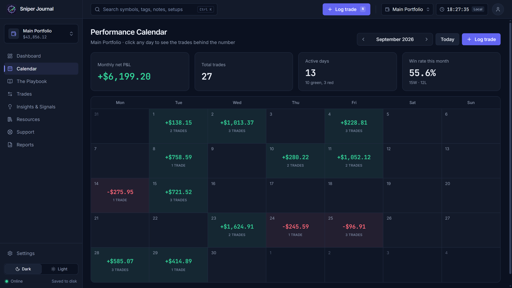

  

<h1 align="center">Sniper Journal</h1>

  A private trading journal for Windows and Android. 
  Log your trades and see whether you really have an edge.

  

  

  
  
  

## What you get

- **Log every trade.** Entry and exit, size, stop loss and take profit, fees,
  setup, tags, notes and a screenshot of the chart. Rate your discipline,
  execution and patience on each one.
- **Your real numbers.** Net profit, win rate, profit factor, expectancy,
  average reward-to-risk, an equity curve with your maximum drawdown, and a
  daily P&L chart.
- **Performance calendar.** Every day's profit or loss at a glance. Click a day
  to see its trades.
- **Insights.** Patterns found in your own trades, in plain words: your best
  session, the weekday that costs you, whether you hold losers longer than
  winners. Set a daily loss limit and get a warning as you get close.
- **Your playbook.** Write down the setups you trade and their rules, then see
  how each setup really performs and what breaking a rule cost you.
- **Import from your broker.** CSV or Excel files from 30 platforms, including
  NinjaTrader, Tradovate, TopstepX, Interactive Brokers, thinkorswim, MetaTrader
  and Binance. You see a preview before anything is added.
- **Reports** by month, symbol, setup and weekday.
- **Several accounts**, such as a live account, a prop firm challenge and a
  practice account, kept apart or viewed together.
- **Dark and light themes**, and test trades to explore with that you remove in
  one click.

## Install

### Windows 10 and 11

Get it free from the Microsoft Store:
**<https://apps.microsoft.com/detail/9NJC9KKLMTN5>**

Click **Get**. It installs like any other app and updates itself.

### Android

1. On your phone, open the
   [latest release](https://github.com/Reefk/SniperJournal/releases/latest).
2. Under **Assets**, tap the `.apk` file to download it, then open it.
3. If Android asks, allow your browser or Files app to install apps, then tap
   **Install**.

Needs Android 7.0 or newer. The full steps, with what to expect from Google
Play Protect, are in
[Installing Sniper Journal on Android](docs/install-android.md).

## Your data stays yours

- No account, no sign-up, no ads, no tracking.
- The app never connects to the internet. Your journal stays on your device.
- **Windows:** your journal is a file in `Documents\Sniper Journal`, with an
  automatic daily backup (the last 30 are kept). Uninstalling the app leaves it
  there.
- **Android:** your journal is kept in the app's private storage, and
  uninstalling deletes it. Save a backup first from **More → Back up your
  journal**.

Read the [privacy policy](docs/privacy-policy.md).

---

Sniper Journal is a record-keeping and analysis tool. It doesn't place trades,
connect to brokers or give investment advice.

Want to build it yourself or change the code? See [DEVELOPING.md](DEVELOPING.md).
